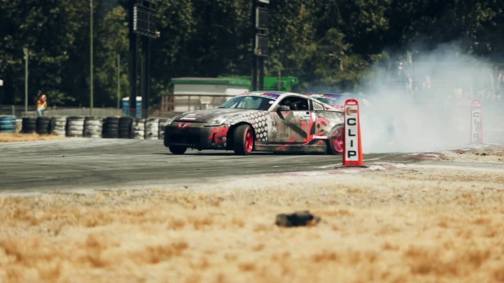
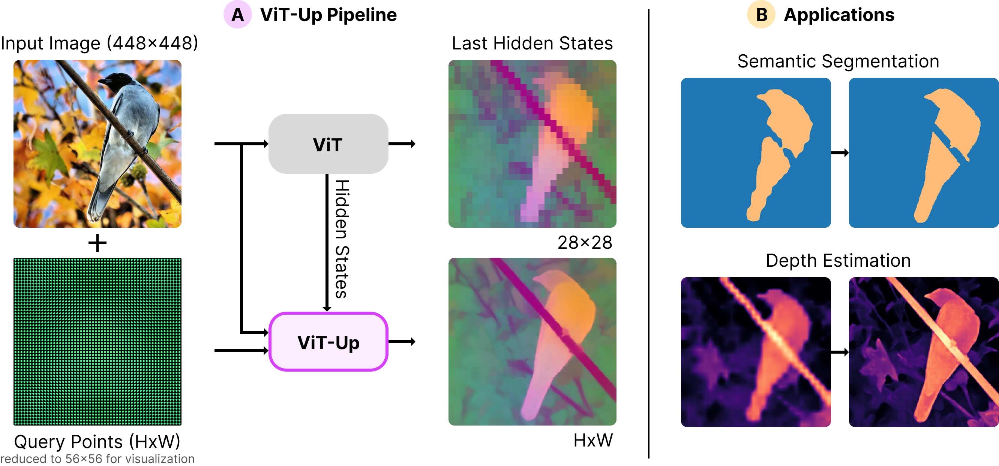
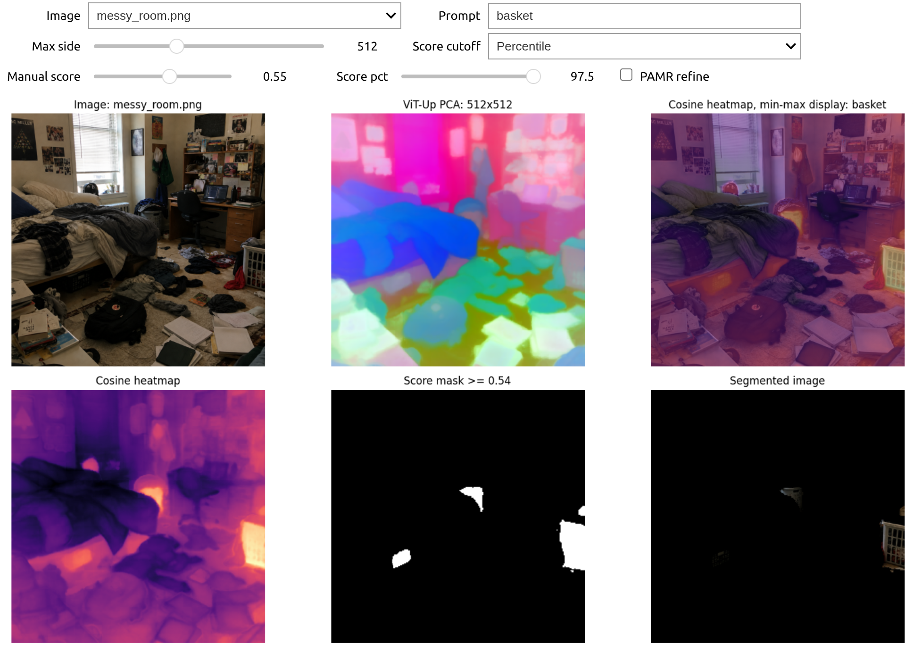

<div align="center">

# ViT-Up: Faithful Feature Upsampling for Vision Transformers

**[Krispin Wandel](https://link.discuna.com/vitupkw) · [Jingchuan Wang](https://robotics.sjtu.edu.cn/en/minglu/465.html) · [Hesheng Wang](https://irmv.sjtu.edu.cn/wanghesheng)**

[](https://vitup.papers.discuna.com/)
[](https://arxiv.org/abs/2606.14024)
[](https://huggingface.co/spaces/Krispin/vit-up)
[](https://huggingface.co/Krispin/vit-up)
[](https://huggingface.co/papers/2606.14024)
[](https://colab.research.google.com/github/krispinwandel/vit-up/blob/main/inference_example_colab.ipynb)
[](https://app.discuna.com/invite/krispinwandel)



<sub>Dense ViT-Up features (<code>dinov3_splus_g28_56</code>) computed frame by frame and projected to RGB with PCA.</sub>

</div>

ViT-Up is an implicit feature upsampler for Vision Transformers that predicts backbone-aligned features at **arbitrary
continuous image coordinates**. It is pretrained through self-supervised feature distillation on ImageNet-1K and
lets downstream heads operate directly on dense DINOv3 features, which helps with data-constrained dense prediction
and fine-grained correspondence.

> [!TIP]
> No setup needed: try ViT-Up in the [Hugging Face demo](https://huggingface.co/spaces/Krispin/vit-up) or the
> [Colab notebook](https://colab.research.google.com/github/krispinwandel/vit-up/blob/main/inference_example_colab.ipynb).

<p align="center">
  
</p>

## Contents

- [Installation](#installation)
- [Quick Start](#quick-start)
- [Pretrained Models](#pretrained-models)
- [Training](#training)
- [Results](#results)
- [Evaluation](#evaluation)
  - [Linear probing](#linear-probing)
  - [Correspondence](#correspondence)
  - [Video segmentation](#video-segmentation)
  - [Runtime](#runtime)
  - [Output and backbone resolution](#output-and-backbone-resolution)
- [Experimental Demos](#experimental-demos)
  - [Open-vocabulary segmentation](#open-vocabulary-segmentation)
  - [Video encoding](#video-encoding)
- [Citation](#citation)

## Installation

```bash
git clone https://github.com/krispinwandel/vit-up.git && cd vit-up
uv sync            # or: pip install -e . --find-links https://whl.natten.org
hf auth login      # DINOv3 is gated: request access on its Hugging Face model page first
```

The pinned environment uses Python 3.11, PyTorch 2.9 and CUDA 12.8.

## Quick Start

Encode an image once, then query its features anywhere: at individual points or on a dense grid of any
resolution.

```python
import torch
from PIL import Image

from vit_up.inference import ViTUpWrapper

model = ViTUpWrapper("dinov3_splus")  # a release name or a checkpoint directory

# 1. Encode the image once.
model.set_images(Image.open("assets/vegi_store.png").convert("RGB"))

# 2. Query features at any continuous (x, y) position, normalized to [0, 1].
points = torch.tensor([[[0.25, 0.50], [0.70, 0.33]]])  # (B, N, 2)
features = model(query_coords=points)                  # (B, N, C)

# ...or on a dense grid at any output resolution.
dense = model.dense(output_size=896)                   # (B, 896, 896, C)
```

Every query reuses the encoded image, so querying is cheap.

- **Inputs:** PIL images or ImageNet-normalized `(B, 3, H, W)` tensors, resized to the backbone resolution
  (448 px by default, `image_size=...`).
- **All layers:** `return_all_layers=True` returns one `(B, N, C)` tensor per selected backbone layer.
- **Precision:** inference runs under bf16 autocast; pass `use_bfloat16=False` for fp32.
- **Memory:** large query sets are decoded in chunks with `query_chunk_size=...`, which does not change the output.

The same models are available through **Torch Hub**; keyword arguments are passed to `ViTUpWrapper`:

```python
model = torch.hub.load("krispinwandel/vit-up", "vit_up_dinov3_splus", trust_repo=True)
model.set_images(image)
features = model(query_coords=points)
```

See [notebooks/inference_example.ipynb](notebooks/inference_example.ipynb) for a PCA visualization of the features.

## Pretrained Models

All checkpoints are hosted at [Krispin/vit-up](https://huggingface.co/Krispin/vit-up) and are downloaded on first use.

| Release | Torch Hub entry point | Backbone | Training |
|---|---|---|---|
| `dinov3_splus` ⭐ | `vit_up_dinov3_splus` | DINOv3-S+ | Stage 2 (main model) |
| `dinov3_splus_stage1` | `vit_up_dinov3_splus_stage1` | DINOv3-S+ | Stage 1 |
| `dinov3_splus_g28_56` | `vit_up_dinov3_splus_g28_56` | DINOv3-S+ | Stage 2 at 448 and 896 px (28×28 and 56×56 backbone grids); runs at 896 px by default |
| `dinov3_base` | `vit_up_dinov3_base` | DINOv3-B | Stage 2 |
| `dinov3_base_stage1` | `vit_up_dinov3_base_stage1` | DINOv3-B | Stage 1 (the first DINOv3-B release) |
| `dinov2_small` | `vit_up_dinov2_small` | DINOv2-S | Stage 2 |
| `dinov2_small_g32_64` | `vit_up_dinov2_small_g32_64` | DINOv2-S | Stage 2 at 448 and 896 px (32×32 and 64×64 backbone grids); runs at 896 px by default |

Training has two stages:

1. **Stage 1** distills the frozen backbone into ViT-Up while training LoRA adapters of the backbone.
2. **Stage 2** refines the model by self-distillation from the frozen Stage 1 model, with the adapters merged into
   the backbone.

## Training

Training composes the Hydra configs in `configs/` with an experiment from `experiments/`. For example, the main model:

```bash
python main.py --config-name experiments/stage1/dinov3_splus
python main.py --config-name experiments/stage2/dinov3_splus
```

<details>
<summary><b>All training recipes</b></summary>

| Experiment | Produces | Initialized from |
|---|---|---|
| `experiments/stage1/dinov3_splus` | `dinov3_splus_stage1` | – |
| `experiments/stage2/dinov3_splus` | `dinov3_splus` | `dinov3_splus_stage1` |
| `experiments/stage1/dinov3_splus_g28_56` | – | `dinov3_splus_stage1` |
| `experiments/stage2/dinov3_splus_g28_56` | `dinov3_splus_g28_56` | output of `stage1/dinov3_splus_g28_56` |
| `experiments/stage2/dinov3_base` | `dinov3_base` | `dinov3_base_stage1` |
| `experiments/stage1/dinov2_small` | – | – |
| `experiments/stage2/dinov2_small` | `dinov2_small` | output of `stage1/dinov2_small` |
| `experiments/stage1/dinov2_small_g32_64` | – | output of `stage1/dinov2_small` |
| `experiments/stage2/dinov2_small_g32_64` | `dinov2_small_g32_64` | output of `stage1/dinov2_small_g32_64` |

</details>

**Data.** ImageNet-1K is streamed from the Hugging Face Hub (`ILSVRC/imagenet-1k`, which requires accepting its
license).

**Outputs.** Runs write to `outputs/training/<name>/`:

- `checkpoints/best` and `checkpoints/last`: the model with the lowest validation loss and the final model. Both work
  with `ViTUpWrapper`, `initialization=...` and the evaluation configs.
- `lightning/`: Lightning checkpoints for resuming.

**Overrides.** Any setting can be changed on the command line:

```bash
python main.py --config-name experiments/stage2/dinov3_splus \
  initialization=outputs/training/stage1_dinov3_splus/checkpoints/best \
  logger=wandb schedule.batch_size=8 schedule.accumulate_grad_batches=2 \
  ckpt_path=outputs/training/stage2_dinov3_splus/lightning/last.ckpt   # resume
```

> [!NOTE]
> Add `--cfg job --resolve` to print the composed config without training. All recipes train on one GPU with bf16
> mixed precision; `val_check_interval` counts batches, so recipes with gradient accumulation scale it accordingly.

## Results

Main results of the paper on DINOv3-S+ (×100; best in bold). The rows "ViT-Up + LoRA" and "ViT-Up + LoRA + Stage 2" are the
`dinov3_splus_stage1` and `dinov3_splus` releases; the variant without LoRA is not released.

**Dense linear probing.** Linear heads trained on the upsampled features:

| Method | COCO mIoU ↑ | VOC mIoU ↑ | ADE20K mIoU ↑ | Cityscapes mIoU ↑ | COCO depth δ1 ↑ | COCO depth RMSE ↓ |
|---|---|---|---|---|---|---|
| Bilinear | 63.10 | 84.88 | 43.27 | 61.36 | 61.39 | 63.01 |
| DPT | 61.74 | 84.64 | 41.95 | 61.89 | 59.83 | 64.36 |
| JAFAR | 62.50 | 83.88 | 42.48 | 57.78 | 60.98 | 64.35 |
| AnyUp | 63.03 | 84.54 | 42.77 | 58.96 | 61.56 | 62.54 |
| UpLiFT | 63.79 | 85.69 | 44.24 | 63.08 | 61.90 | 61.32 |
| NAF | 63.86 | 85.84 | 44.17 | 63.34 | 62.28 | 60.69 |
| ViT-Up w/o LoRA | 64.06 | 86.97 | **45.10** | 66.27 | 62.57 | 59.91 |
| ViT-Up + LoRA | 64.08 | 87.45 | 44.78 | 65.44 | 63.12 | 59.19 |
| **ViT-Up + LoRA + Stage 2** | **64.24** | **87.59** | 45.00 | **66.42** | **63.35** | **58.48** |

**Correspondence.** SPair-71k PCK at three thresholds and NAVI 3D recall at three distances:

| Method | SPair 0.10 ↑ | SPair 0.05 ↑ | SPair 0.01 ↑ | NAVI 5 cm ↑ | NAVI 2 cm ↑ | NAVI 1 cm ↑ |
|---|---|---|---|---|---|---|
| Bilinear | 51.27 | 33.74 | 3.83 | 80.16 | 51.18 | 33.58 |
| DPT | 50.86 | 34.98 | 6.75 | 79.53 | 51.49 | 34.33 |
| JAFAR | 36.82 | 18.59 | 1.89 | 79.04 | 47.02 | 26.60 |
| AnyUp | 37.63 | 19.31 | 1.97 | 80.31 | 48.78 | 28.37 |
| UpLiFT | 46.87 | 29.15 | 3.43 | 79.35 | 49.05 | 30.49 |
| NAF | 48.68 | 33.96 | 2.89 | 80.03 | 50.29 | 31.62 |
| ViT-Up w/o LoRA | 55.46 | 39.28 | 7.38 | **81.12** | **53.72** | **36.39** |
| ViT-Up + LoRA | 55.60 | 39.43 | 7.75 | 80.67 | 53.21 | 35.93 |
| **ViT-Up + LoRA + Stage 2** | **56.39** | **41.18** | **8.98** | 80.10 | 52.32 | 35.51 |

**Video object segmentation.** DAVIS-2017 J&F with LILA's linear-probing and k-NN protocols, using only the dense
features. ViT-Up is the Stage 2 model trained on two backbone grids (`dinov2_small_g32_64`, `dinov3_splus_g28_56`):

| Method | DINOv2-S probing ↑ | DINOv2-S k-NN ↑ | DINOv3-S+ probing ↑ | DINOv3-S+ k-NN ↑ |
|---|---|---|---|---|
| Bilinear | 58.6 | 62.2 | 63.7 | 63.3 |
| LILA | 64.5 | 73.9 | – | – |
| NAF | 62.6 | 65.9 | 63.9 | 62.8 |
| UpLiFT | 65.1 | 69.9 | 66.0 | 67.4 |
| **ViT-Up** | **67.3** | **76.0** | **69.5** | **73.1** |

The paper additionally reports frozen-head evaluation, DINOv3-B and DINOv2-S results, backbone and output
resolution, ablations and runtime. The [Evaluation](#evaluation) section shows how to run every benchmark.

## Evaluation

The evaluation toolkits are configured with Hydra (`vit_up/eval_kits/config`). Results are written to `outputs/eval/`.

**1. Download the datasets** into `data/`:

```bash
python scripts/download_datasets.py   # --help lists the datasets; Cityscapes needs --city_un/--city_pwd
```

**2. Pick a method** with `model=<backbone>/<method>`:

| Backbone | Methods |
|---|---|
| `dinov3_splus` | `vit_up`, `vit_up_stage1`, `vit_up_g28_56`, `bilinear`, `anyup`, `jafar`, `naf`, `uplift` |
| `dinov3_base` | `vit_up`, `vit_up_stage1`, `bilinear`, `naf` |
| `dinov2_small` | `vit_up`, `vit_up_g32_64`, `bilinear`, `anyup`, `jafar`, `loftup`, `naf`, `uplift` |

To evaluate your own checkpoint, use `model=vit_up model.checkpoint=<directory> model.feature_dim=<C>`.

**3. Run a benchmark** from the sections below. Each command evaluates ViT-Up; the comments list the alternatives.

### Linear probing

```bash
MODEL=dinov3_splus/vit_up   # any <backbone>/<method> from the table above
MODE=train                  # train: train a linear head on the upsampled features, then evaluate it
                            # eval: apply a head trained on native DINOv3-S+ features (frozen-head
                            #       evaluation; assets/pretrained_heads, dinov3_splus methods only)
DATASET=voc                 # voc, cityscapes, coco, ade20k; depth: coco with task=depth
python -m vit_up.eval_kits.probing_toolkit.run_probing model=$MODEL \
  schedule/mode=$MODE schedule/dataset=$DATASET dataset_evaluation=$DATASET
```

### Correspondence

```bash
MODEL=dinov3_splus/vit_up   # any <backbone>/<method> from the table above
python -m vit_up.eval_kits.correspondence_2d_toolkit.run_correspondence_2d model=$MODEL                # SPair-71k PCK
python -m vit_up.eval_kits.geometric_correspondence_toolkit.evaluate_navi_correspondence model=$MODEL  # NAVI 3D recall
```

### Video segmentation

DAVIS-2017 video object segmentation with [LILA's](https://github.com/google-research/google-research/tree/master/lila)
protocols:

```bash
python -m vit_up.eval_kits.video_seg_toolkit.prepare_data davis --data-root data

MODEL=dinov2_small/vit_up   # any <backbone>/<method> from the table above,
                            # dinov2_small/lila (the released LILA checkpoint), or
                            # none (the plain backbone; add encoder.backbone_model_name=<Hugging Face model>)
BENCHMARK=vos_probe         # vos_probe (linear probe), vos_knn (k-NN propagation), vos_knn_sweep
python -m vit_up.eval_kits.video_seg_toolkit.run_video_seg model=$MODEL benchmark=$BENCHMARK
# DINOv3 backbones (16 px patches) need a patch-aligned probe input: add benchmark.resize_input_size=480
```

See the [toolkit README](vit_up/eval_kits/video_seg_toolkit/README.md) for the feature modes and our results.

### Runtime

Latency and peak memory from an image to dense features, including the backbone:

```bash
MODEL=dinov3_splus/vit_up   # dinov3_splus/{anyup, jafar, naf, uplift, loftup_runtime}
python -m vit_up.eval_kits.runtime_toolkit.run_runtime_bench model=$MODEL
# ViT-Up only: model.query_chunk_size=12544 (default, 112^2), 50176 (224^2) or null (all queries at once)
```

`loftup_runtime` runs LoftUp's DINOv2-S checkpoint on DINOv3-S+ features, for timing only.

### Output and backbone resolution

```bash
SIZE=112   # ViT-Up decodes a SIZE x SIZE grid, bilinearly resized to the output size: 28, 56, 112, 224, null (output size)
python -m vit_up.eval_kits.probing_toolkit.run_probing model=dinov3_splus/vit_up model.decode_size=$SIZE \
  schedule/mode=train schedule/dataset=voc dataset_evaluation=voc

PX=896     # bilinear baseline with the backbone at PX pixels (PX/16 tokens per side): 448, 896, 1792
python -m vit_up.eval_kits.correspondence_2d_toolkit.run_correspondence_2d model=dinov3_splus/bilinear \
  model.img_in_size=$PX model.out_size=448   # model.out_size=448 is for correspondence only
```

## Experimental Demos

### Open-vocabulary segmentation

The notebook [notebooks/talking_to_vit-up.ipynb](notebooks/talking_to_vit-up.ipynb) combines dense ViT-Up DINOv3-B
features with the Talk2DINO text projection model for prompt-based segmentation. Install the extra dependencies with
`uv sync --extra demo`.

<p align="center">
  
</p>

This demo builds on [Talking to DINO: Bridging Self-Supervised Vision Backbones with Language for Open-Vocabulary
Segmentation](https://arxiv.org/abs/2411.19331).

### Video encoding

`scripts/encode_video.py` extracts dense ViT-Up features from every frame of a video, fits one global three-component
PCA and renders it as an RGB video. Frames are padded to squares for inference, while queries and outputs keep the
video's aspect ratio.

```bash
python scripts/encode_video.py input.mp4 --width 640 --output-dir outputs

# Restrict queries and PCA to the foreground of a segmentation video
python scripts/encode_video.py input.mp4 --width 640 --pca-nframes 10 --seg-video segmentation.mp4 --output-dir outputs
```

The segmentation video is thresholded in grayscale (`--seg-threshold`, default 127). For `input.mp4`, the output
folder contains:

| File | Content |
|---|---|
| `input_features.npy` | `(T, H, W, D)` features |
| `input_pca_features.npy` | `(T, H, W, 3)` PCA-projected features |
| `input_pca.npz` | PCA basis, normalization and RGB range |
| `input_pca_rgb.mp4` | RGB rendering of the PCA |
| `input_features.json` | Metadata used to reuse cached features |

Read feature frames lazily with:

```python
from vit_up.video_features import make_read_ft_frame

read_ft_frame = make_read_ft_frame("outputs/input_features.npy")
frame = read_ft_frame(0)  # .features (H, W, D), .mask, .rgb and .pca_rgb when available
```

## Citation

If you find ViT-Up useful, please cite:

```bibtex
@misc{wandel2026vitupfaithfulfeatureupsampling,
      title={ViT-Up: Faithful Feature Upsampling for Vision Transformers},
      author={Krispin Wandel and Jingchuan Wang and Hesheng Wang},
      year={2026},
      eprint={2606.14024},
      archivePrefix={arXiv},
      primaryClass={cs.CV},
      url={https://arxiv.org/abs/2606.14024},
}
```
